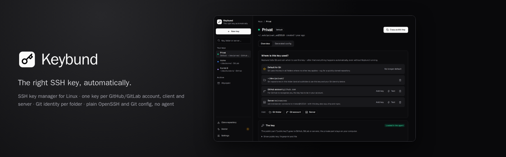
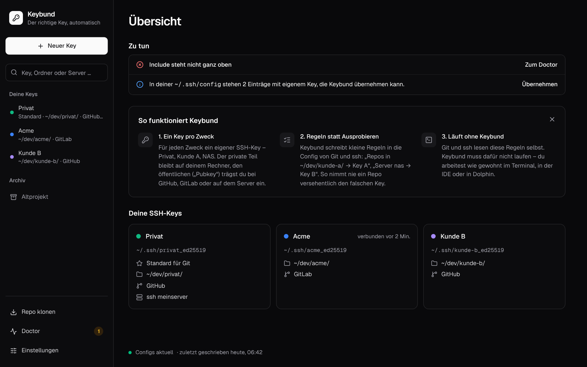
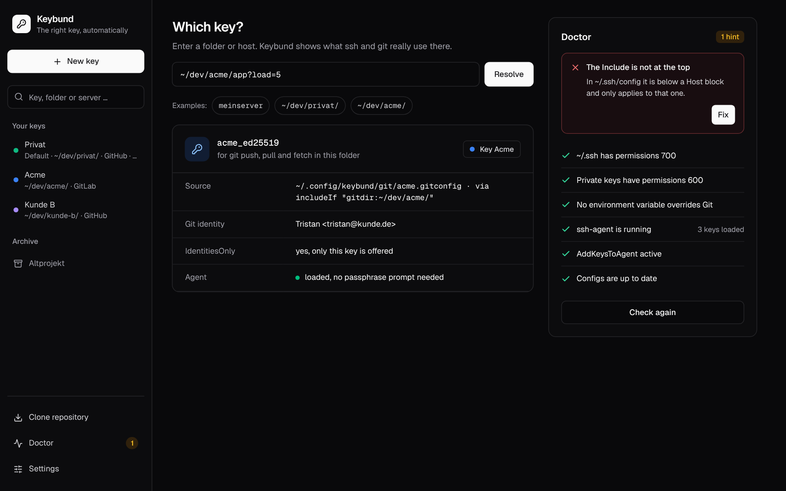
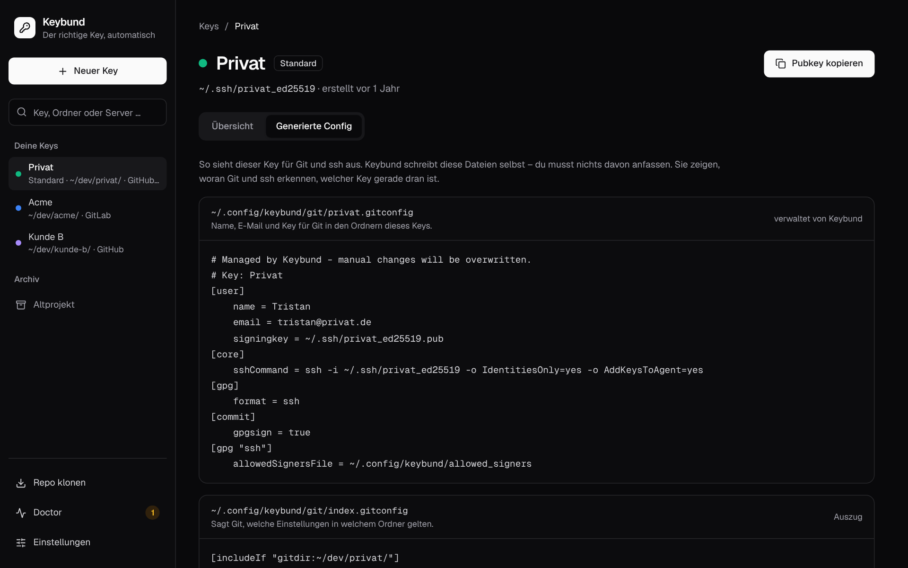
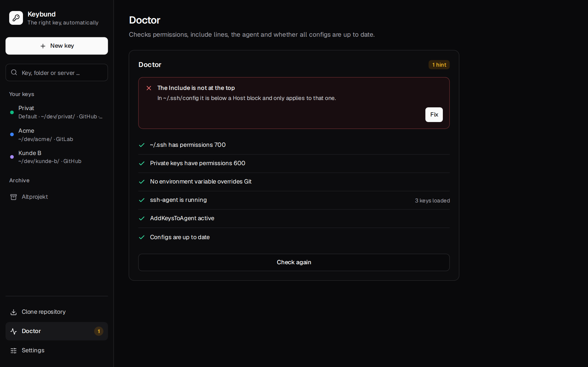
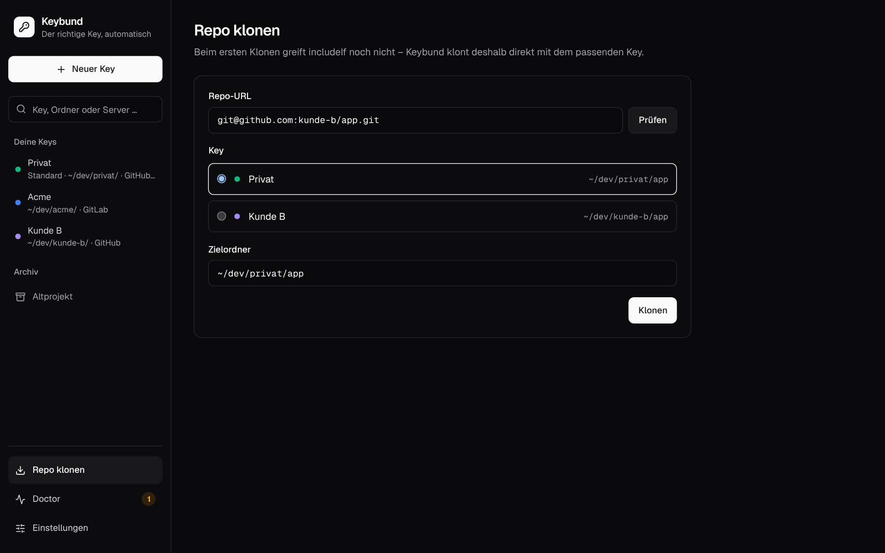

<div align="center">



**The right SSH key, automatically – an SSH key manager for Linux and macOS.**<br>
One key per GitHub, GitLab or Bitbucket account, per client and per server, the right Git e-mail per folder.<br>
Plain OpenSSH and Git config underneath: no agent, no daemon, nothing that has to keep running.

[](https://github.com/firsttris/keybund/actions/workflows/ci.yml)
[](https://github.com/firsttris/keybund/releases/latest)
[](https://firsttris.github.io/keybund/)
[](https://www.rust-lang.org/)
[](https://tauri.app/)
[](LICENSE)

[Why](#-why-keybund) •
[Install](#-install) •
[Features](#-features) •
[Screenshots](#-screenshots) •
[How it works](#️-how-it-works) •
[FAQ](#-faq) •
[Documentation](https://firsttris.github.io/keybund/) •
[Development](#️-development)


</div>

## 💡 Why Keybund?

You have a private GitHub account and a work account. Or one key per client, a NAS and two servers.
And sooner or later `git push` answers `Permission denied (publickey)`, pushes with the wrong account,
or a commit goes out with the wrong e-mail. The fix is always the same handful of `~/.ssh/config`
blocks, `includeIf` rules and `core.sshCommand` lines – easy to get subtly wrong, hard to keep tidy.

- **Say where a key belongs, not how.** Create a key, add a Git folder (`~/dev/client-a/`), a GitHub
  account or a server. Keybund writes the `Host` blocks, `includeIf "gitdir:…"` rules and Git
  identities – correctly ordered, with `IdentitiesOnly`, quoted and validated.
- **Works without Keybund.** The result is standard OpenSSH and Git configuration. Terminal, IDE,
  Dolphin and cron jobs pick the right key on their own; close Keybund, or remove it, and everything
  keeps working.
- **Your config stays yours.** Keybund writes its own files and adds exactly one `Include` line to
  `~/.ssh/config` and one to `~/.gitconfig`, after a backup. `keybund uninstall` takes it all back.
- **It checks, instead of guessing.** “Which key applies here?” asks `git` and `ssh -G`. The
  connection test reads `ssh -v` to see which key the server *really* accepted. The doctor finds the
  classic traps: a stray `IdentityFile` under `Host *`, `GIT_SSH_COMMAND` in your `.bashrc`, an
  `Include` in the wrong place.
- **Safe by default.** Private keys are never read, passphrases never touch the command line, host
  keys are confirmed by fingerprint instead of trusted on first use.

## 🚀 Install

Download from the [latest release](https://github.com/firsttris/keybund/releases/latest):

```sh
# Desktop app – any distribution
chmod +x Keybund_*_amd64.AppImage && ./Keybund_*_amd64.AppImage

# … or on Debian/Ubuntu
sudo apt install ./keybund_*_amd64.deb

# macOS: open Keybund_*_universal.dmg, drag Keybund to Applications
# (not notarized yet: the first start needs “Open Anyway”, see the installation guide)

# Command line (optional, same data as the app)
tar -xzf keybund-cli-*-x86_64-linux.tar.gz && install -m 755 keybund ~/.local/bin/
```

Then: **New key** → give it a name → say where it is used. Already have a `~/.ssh/config` full of
`Host` blocks? Keybund offers to take them over in one click and leaves your key files where they are.
The app speaks English and German and follows your system language.

Requirements, building from source and uninstalling: [installation guide](https://firsttris.github.io/keybund/installation.html) ·
first ten minutes: [first steps](https://firsttris.github.io/keybund/getting-started.html).

### 🐧 Runs on

| | | Notes |
|---|---|---|
| ✅ | Linux x86_64 with glibc 2.35 or newer – Ubuntu 22.04+, Debian 12+, Fedora, Bazzite, Arch, openSUSE … | KDE, GNOME and others, Wayland and X11 |
| ✅ | macOS 11 or newer, Apple Silicon and Intel | passphrases in the Keychain, own password dialog |
| ✅ | GitHub, GitLab (also self-hosted), Bitbucket | “add key” opens the right page, tests show the logged-in account |
| ✅ | Any SSH server, NAS, Raspberry Pi, Gitea, Forgejo | adds the key like `ssh-copy-id` |
| ✅ | Terminal, VS Code, JetBrains, Dolphin (`sftp://`), `scp`, `rsync` | anything that uses OpenSSH or Git |
| ⏳ | Windows | not yet |

## ✨ Features

| | |
|---|---|
| 🔑 **One key per purpose** | Create Ed25519 keys (with an optional passphrase) or take over existing ones from `~/.ssh` – nothing is moved |
| 📁 **Git folders** | Every repository below `~/dev/client-a/` pushes with that client's key and commits with its e-mail – with the normal `git@github.com:…` URL |
| 👥 **Multiple accounts** | Two or ten GitHub/GitLab/Bitbucket accounts on one machine, by folder or by alias (`git@github-work:org/repo.git`) |
| 🖥️ **Servers** | `ssh nas`, `ssh 192.168.1.20`, `scp`, `rsync` and `sftp://nas` all use the right key; “add key” works like `ssh-copy-id` |
| ⭐ **Default key** | Optional: one key for every repository outside your Git folders |
| ✅ **Connection test** | Step by step in plain words: connection, host key, offered key, accepted key, logged in as `@account` – and the fix when something is wrong |
| 🔍 **Which key?** | Type a folder or host: Keybund asks Git and ssh what they really use, and why |
| 🩺 **Doctor** | Permissions, include positions, the agent, overriding environment variables, old entries, Dolphin's libssh – with one-click fixes |
| 📥 **Take over your ~/.ssh/config** | Existing `Host` blocks become keys in one click; old entries are removed after a backup |
| ✍️ **Commit signing** | Sign commits with the SSH key per folder (`gpg.format=ssh`), with an allowed-signers file for local verification |
| 📦 **Clone helper** | Clones into the right folder with the right key – even before `includeIf` can apply |
| 🗄️ **Archive** | When a project ends: key to `~/.ssh/archive/`, configuration gone, links to remove it at the provider |
| 🛡️ **Host keys** | Fingerprints confirmed before the first connection, GitHub/GitLab/Bitbucket keys pinned, known_hosts per key |
| ⌨️ **CLI** | Everything also as `keybund …`, scriptable with `--yes` and exit codes |
| 🌍 **English and German** | Follows the system language, switchable in the settings – error messages, doctor and connection tests included |
| 🌓 **Light and dark** | Follows the light or dark mode of your desktop, or a fixed choice in the settings |

## 📸 Screenshots

<table>
  <tr>
    <td width="50%"><br><sub><b>Overview</b> – what to do, every key at a glance · <a href="https://firsttris.github.io/keybund/app.html#overview">docs →</a></sub></td>
    <td width="50%"><br><sub><b>Connection test</b> – what ssh did, in plain words · <a href="https://firsttris.github.io/keybund/app.html#wo-wird-dieser-key-benutzt-where-is-this-key-used">docs →</a></sub></td>
  </tr>
  <tr>
    <td><br><sub><b>Which key?</b> – asks Git and ssh directly · <a href="https://firsttris.github.io/keybund/app.html#which-key-welcher-key">docs →</a></sub></td>
    <td><br><sub><b>Generated config</b> – exactly what is written · <a href="https://firsttris.github.io/keybund/generated-files.html">docs →</a></sub></td>
  </tr>
  <tr>
    <td><br><sub><b>Take over ~/.ssh/config</b> – one click, with backup · <a href="https://firsttris.github.io/keybund/getting-started.html#taking-over-an-existing-setup">docs →</a></sub></td>
    <td><br><sub><b>Doctor</b> – finds the classic traps, fixes them · <a href="https://firsttris.github.io/keybund/troubleshooting.html">docs →</a></sub></td>
  </tr>
  <tr>
    <td><br><sub><b>New key</b> – a name, that's it · <a href="https://firsttris.github.io/keybund/getting-started.html#1-create-a-key">docs →</a></sub></td>
    <td><br><sub><b>Clone</b> – right folder, right key · <a href="https://firsttris.github.io/keybund/guides.html#cloning-into-the-right-folder-with-the-right-key">docs →</a></sub></td>
  </tr>
</table>

## ⚙️ How it works

Keybund keeps your keys and where they are used in `~/.config/keybund/profiles.toml` and derives
standard configuration from it:

```sshconfig
# ~/.ssh/config – one line added at the top
Include ~/.ssh/config.d/keybund.conf
```

```sshconfig
# ~/.ssh/config.d/keybund.conf – a block per server, matching alias and IP
Host nas 192.168.1.20
    HostName 192.168.1.20
    User admin
    IdentityFile ~/.ssh/nas_ed25519
    IdentitiesOnly yes
    AddKeysToAgent yes
```

```ini
# ~/.config/keybund/git/index.gitconfig – included as the last entry of ~/.gitconfig
[includeIf "gitdir:~/dev/client-a/"]
	path = ~/.config/keybund/git/client-a.gitconfig

# ~/.config/keybund/git/client-a.gitconfig
[user]
	email = you@client-a.com
[core]
	sshCommand = ssh -i ~/.ssh/client-a_ed25519 -o IdentitiesOnly=yes -o AddKeysToAgent=yes
```

So `git push` in `~/dev/client-a/app` runs ssh with exactly the client's key, and `ssh nas` uses the
NAS key – whoever calls them. Why each line is there, how the includes are ordered and how backups
work: [what Keybund writes](https://firsttris.github.io/keybund/generated-files.html).

## ❓ FAQ

<details>
<summary><b>How do I use two GitHub accounts on one computer?</b></summary>

Create a key per account and give each a Git folder, e.g. `~/dev/private/` and `~/dev/work/`. Every
repository below a folder pushes with its key, with the normal `git@github.com:…` remote. Or give an
account an alias and clone `git@github-work:org/repo.git`. See the
[guide](https://firsttris.github.io/keybund/guides.html#two-github-accounts-on-one-computer).
</details>

<details>
<summary><b>Does Keybund have to keep running? Does it replace ssh-agent?</b></summary>

No and no. Keybund writes configuration files and is done; ssh and Git read them on their own. It
uses your existing ssh-agent (KDE, GNOME and most desktops start one) and writes `AddKeysToAgent yes`,
so a passphrase is typed once per session.
</details>

<details>
<summary><b>Does it upload my keys or need a GitHub token?</b></summary>

No. Keybund makes no network connections of its own and never reads private keys. “Add key” copies
the public key and opens the provider's page in your browser; on servers it logs in with ssh like
`ssh-copy-id`.
</details>

<details>
<summary><b>What happens to my existing ~/.ssh/config and ~/.gitconfig?</b></summary>

Each gets one include line, after a backup; nothing else in them is changed. Existing `Host` blocks
with their own key can be taken over, and removed afterwards if you want (again with a backup).
`keybund uninstall --restore-backups` restores both files.
</details>

<details>
<summary><b>Why does Keybund not write <code>Host github.com</code>?</b></summary>

Because a `Host github.com` block with an `IdentityFile` adds that key to every connection to GitHub
– the classic cause of pushing with the wrong account. Keybund selects the key per folder through
Git's `core.sshCommand`, and writes `Host` blocks for Git providers only with an alias.
</details>

<details>
<summary><b>Does it work with Dolphin, VS Code, JetBrains IDEs?</b></summary>

Yes – they all use OpenSSH's or Git's configuration. Dolphin reads it through libssh; for libssh
before 0.10.2 (e.g. Ubuntu 22.04) the doctor offers the include with the full path.
</details>

More in the [FAQ](https://firsttris.github.io/keybund/faq.html).

## 📚 Documentation

Installation, first steps, common setups, the app, every CLI command, `profiles.toml`, the generated
files, security and host keys, troubleshooting, architecture and modules – all in the
**[documentation](https://firsttris.github.io/keybund/)**.

## 🛠️ Development

```sh
packaging/toolbox.sh && toolbox enter keybund-dev   # Fedora/Bazzite: toolbox with all build dependencies
just setup          # frontend dependencies
just dev            # the app with hot reload
just dev-mock       # only the frontend, in the browser, against an in-memory demo backend
just                # lint + every test: Rust unit/snapshot/integration (real git, ssh, sshd), Vitest, Playwright
```

A Rust core (`crates/core`) with a CLI (`crates/cli`) and a Tauri 2 app (`app/`, React, TanStack,
shadcn/ui) on top. The [development guide](https://firsttris.github.io/keybund/development.html)
covers the setup, the mock backend, bindings, screenshots and releases;
[architecture](https://firsttris.github.io/keybund/architecture.html) and
[modules](https://firsttris.github.io/keybund/modules.html) explain how it all fits together.

---

<div align="center">

⭐ Like Keybund? A [star on GitHub](https://github.com/firsttris/keybund) helps others find it.<br>
🐛 [Report a bug](https://github.com/firsttris/keybund/issues/new) · 💡 [Request a feature](https://github.com/firsttris/keybund/issues/new)

<sub>License: <a href="LICENSE">GPL-3.0</a> · © Tristan Teufel and contributors<br>
Changed versions you pass on must stay under the GPL and come with their source code; a commercial license without these obligations is available via <a href="https://teufel-it.de">teufel-it.de</a>.<br>
Keybund is not affiliated with GitHub, GitLab, Atlassian (Bitbucket), KDE or the OpenSSH project.</sub>

</div>
