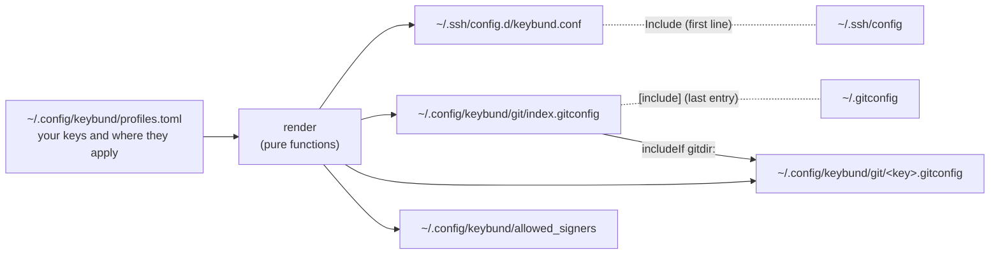

# Keybund documentation

Keybund is an SSH key manager for Linux. You keep one SSH key per purpose – your private GitHub
account, each client, your NAS – and tell Keybund where each key belongs: Git folders, GitHub,
GitLab or Bitbucket accounts, servers. Keybund turns that into plain OpenSSH and Git configuration,
so `git`, `ssh`, `scp`, `rsync`, your IDE and Dolphin pick the right key on their own – without
Keybund running.
Also as a website with search: **https://firsttris.github.io/keybund/**

| | |
|---|---|
| [Installation](installation.md) | AppImage, .deb, the CLI binary, building from source, uninstalling |
| [First steps](getting-started.md) | your first key, adding it to GitHub, a Git folder, a server, testing, taking over an existing `~/.ssh/config` |
| [Common setups](guides.md) | two GitHub accounts on one computer, client work with its own e-mail, servers and NAS, commit signing, cloning |
| [The app](app.md) | every page of the desktop app: overview, key page, new key, “which key?”, doctor, clone, import, settings |
| [Command line](command-line.md) | every `keybund` command and option, exit codes, scripting |
| [Configuration](configuration.md) | `profiles.toml` field by field, settings, validation rules |
| [Troubleshooting](troubleshooting.md) | every doctor check, typical errors and what to do about them |
| [FAQ](faq.md) | short answers to the common questions |
| [What Keybund writes](generated-files.md) | each generated file with an example, how the includes work, backups |
| [Security and host keys](security.md) | private keys, passphrases, host key confirmation, known_hosts per key, file permissions |
| [Architecture](architecture.md) | the data flow from `profiles.toml` to the files, the app's layers, design decisions |
| [Modules](modules.md) | every module of the core, the CLI, the Tauri backend and the frontend |
| [Development](development.md) | toolbox setup, `just` recipes, bindings, mock backend, screenshots, releases |
| [Testing](testing.md) | the test layers, from snapshot tests to a real `sshd` and Playwright |
| [Review 2026-10](review-2026-10.md) | what the code review found, what is fixed, what is still open – with the handover prompt |

## How Keybund works, in one minute

- **One key per purpose.** A key in Keybund is an SSH key pair plus where it is used. Keys are
  created with `ssh-keygen` (Ed25519) or taken over from `~/.ssh`; Keybund never reads a private key.
- **Rules instead of trial and error.** For each key Keybund writes small rules that ssh and Git
  read themselves:
    - a **Git folder** becomes an `includeIf "gitdir:~/dev/client-a/"` with the key's
      `core.sshCommand` and, if you want, its own name and e-mail for commits;
    - a **server** becomes a `Host` block with `IdentityFile` and `IdentitiesOnly yes`, matching its
      alias and its hostname or IP;
    - a **Git account** (GitHub, GitLab, Bitbucket) is reached through the folder or an alias such
      as `git@github-client:…`;
    - an optional **default key** is used by Git everywhere else.
- **Your files stay yours.** Keybund writes its own files under `~/.ssh/config.d/` and
  `~/.config/keybund/` and adds exactly one `Include` line to `~/.ssh/config` and one to
  `~/.gitconfig`, with a backup first. `keybund uninstall` takes it all back.
- **Nothing runs in the background.** No agent, no daemon, no own protocol: once the files are
  written, Keybund can be closed or even removed and everything keeps working.
- **Checked, not guessed.** “Which key?” asks `git config` and `ssh -G` what they really use, the
  connection test reads `ssh -v` to see which key the server accepted, and the doctor checks
  permissions, include positions, the agent and environment variables that would switch Keybund off.

## Who it is for

- Developers with **more than one GitHub, GitLab or Bitbucket account** on the same computer
  (private and work, or one per client) who are tired of `Permission denied (publickey)` and
  commits with the wrong e-mail.
- Freelancers and agencies that keep **a separate key and identity per client** and want to remove
  everything of a client cleanly when the project ends.
- Anyone with a handful of **servers, a NAS or a Raspberry Pi** who wants `ssh nas` to just work –
  in the terminal and in Dolphin (`sftp://nas`).

Keybund runs on Linux (KDE, GNOME and others, X11 and Wayland). The app speaks English and German
(it follows the system language); the CLI's messages are German for now. macOS and Windows are not
supported yet.
