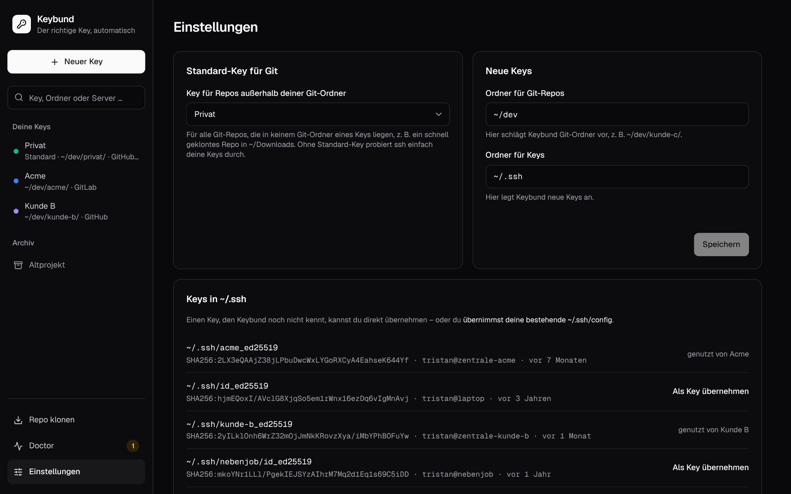

# The app

The desktop app is the comfortable way to use Keybund: a sidebar with your keys, a page per key that
answers “where is this key used?”, and tools for the rest. Every change is written immediately –
there is no “apply” button to forget. The interface is in German; the English meaning of each label
is given here.

## Layout

- **Sidebar** – **Neuer Key** (new key), a search field, **Deine Keys** (your keys) with a coloured dot
  and a one-line summary of where each is used, **Archiv** (archived keys) and the tools at the bottom:
  **Repo klonen** (clone repository), **Doctor** (with the number of open hints) and
  **Einstellungen** (settings).
- **Search** – filters the keys as you type. Press <kbd>Enter</kbd> and it answers *which key applies
  here* for a folder (`~/dev/acme/app`) or a host (`nas`, `github.com`).
- **Status line** – at the bottom of each page: **Configs aktuell** (configs up to date) with the
  time they were last written, or a yellow note if a generated file no longer matches – usually
  because it was edited or deleted by hand. **Ansehen & neu schreiben** (view & rewrite) shows the
  diff and writes the files again.

## Overview

**Übersicht** (overview) shows

- **Zu tun** (to do): failed connection tests, hints from the doctor, keys that are not used
  anywhere yet, and an offer to take over entries from your `~/.ssh/config` – or “Alles in
  Ordnung” (all fine);
- **So funktioniert Keybund** (how Keybund works): three sentences for newcomers, can be closed;
- **Deine SSH-Keys** (your SSH keys): a card per key with its file, what it is used for and when it
  last connected successfully.

## The key page

The header shows the key's name, **Standard** if it is the default key, its file and age, and
**Pubkey kopieren** (copy public key).

### Wo wird dieser Key benutzt? (where is this key used?)

One row per use, each with a short explanation in plain words:

| Row | Actions |
|---|---|
| **Standard für Git** (default for Git) | **Nicht mehr Standard** (no longer default) |
| **Git folder**, e.g. `~/dev/privat/` | remove |
| **GitHub / GitLab / Bitbucket account** | **Key eintragen** (copy public key and open the provider's page), **Testen** (test), remove |
| **Server**, e.g. `meinserver` | **Key eintragen** (put the key into `authorized_keys`, like `ssh-copy-id`), **Testen**, remove |

**Hinzufügen** (add): **Git-Ordner**, **Git-Konto**, **Server**. A test result stays under its row;
**Details: Was beim Test passiert ist** (details: what happened) explains each step of the ssh
connection, shows the command to run it yourself and, on request, ssh's complete output.

Before the first connection to a new server, a dialog shows its host key fingerprint; only after
**Fingerprint stimmt** (fingerprint matches) does ssh connect. When a test fails, the row offers the
fix that fits: the button to add the key, or the hint that a different key was accepted
(“Angemeldet, aber mit ~/.ssh/id_ed25519 statt mit diesem Key” – logged in, but with another key).

### Der Key (the key)

The public key (“Pubkey”), the fingerprint and the file, plus badges: **Im Agent geladen** (loaded in
the ssh-agent, so no passphrase prompt), **Key-Datei fehlt** (key file missing) or **Älter als 2 Jahre
– rotieren** (older than two years – rotate).

### Git-Identität and Commits signieren

The name and e-mail for commits in this key's Git folders. Empty means “as in `~/.gitconfig`”, and
the global identity is shown as a hint. Without a Git folder the card explains that the global
identity applies. **Commits signieren** (sign commits) signs every commit in the key's folders with
this SSH key – see [Signing commits](guides.md#signing-commits-with-your-ssh-key).

### Verwalten (manage)

**Archivieren** (archive) moves the key pair to `~/.ssh/archive/`, removes everything Keybund wrote
for it and lists the pages where you should remove the key at the provider.

### Generierte Config (generated config)

The second tab shows exactly what Keybund writes for this key: its gitconfig, its lines in
`index.gitconfig`, its `Host` blocks and the include lines in your own files – with a sentence on
what each file is for.

## New key

A single short form: **Name**, **Neuen Key erzeugen** (generate, Ed25519) or **Vorhandenen Key
nehmen** (take an existing key from `~/.ssh`), an optional **Passphrase** and, under **Mehr
Optionen**, the comment. After **Key anlegen** (create key) the key page opens, where you say what the
key is for.

## Which key? (Welcher Key?)

Type a folder or host and Keybund asks Git and ssh what they would actually use – not what Keybund
thinks they should use:

- for a **folder**: `git config --show-origin core.sshCommand`, `user.name` and `user.email` inside
  it, and which `includeIf` brought it in (also for linked worktrees);
- for a **host**: `ssh -G <host>` – the key, `IdentitiesOnly`, hostname, user and port;
- for both: whether the key is loaded in the agent, and notes when something is off (a repository
  with its own `core.sshCommand` that overrides the folder rule, a missing key file, no agent).

## Doctor

Checks everything Keybund depends on – permissions, the position of the include lines, environment
variables that switch Keybund off, the agent, old entries in `~/.ssh/config`, Dolphin – and offers
**Beheben** (fix) where a fix is safe. All checks are listed in
[Troubleshooting](troubleshooting.md#doctor-checks).

## Clone repository (Repo klonen)

Paste an SSH URL (`git@github.com:org/repo.git` or `ssh://…`), click **Prüfen**
(check), pick the key if several fit and adjust the target folder. Keybund clones with that key
directly, because `includeIf` cannot apply before the repository exists.

## Taking over an existing ~/.ssh/config (Bestehende SSH-Config übernehmen)

One card per key found in `~/.ssh/config` with a name and an optional Git folder, and the
recommended option to remove the old entries afterwards (with a backup). Details in
[First steps](getting-started.md#taking-over-an-existing-setup).

## Settings (Einstellungen)

- **Standard-Key für Git** – the default key, or **Keiner – ssh wählt selbst** (none – ssh chooses).
- **Neue Keys** – **Ordner für Git-Repos** (where Git folders are suggested, `~/dev`) and **Ordner für
  Keys** (where new keys are created, `~/.ssh`).
- **Keys in ~/.ssh** – every key pair in `~/.ssh` with fingerprint, comment and age; keys Keybund does
  not know yet can be taken over with **Als Key übernehmen**.
- **Für besondere Fälle** (for special cases):
    - **Server-Fingerprints pro Key (known_hosts)** – keep the host keys of each key's servers in
      `~/.ssh/known_hosts.d/<key>` (on by default);
    - **Include mit vollem Pfad** – write the include in `~/.ssh/config` with the full path instead of
      `~`, for Dolphin with an old libssh.
- **Pfade** (paths) – where Keybund keeps its files.
- **Keybund entfernen** (remove Keybund) – takes back everything Keybund wrote, with a preview.
- **Über Keybund** (about) – version, license and source code.

## Without the desktop: the browser preview

The same interface runs in a browser against an in-memory demo backend (`just dev-mock`), which is
what the screenshots and the end-to-end tests use. Nothing on your computer is touched there. See
[Development](development.md#the-mock-backend).
