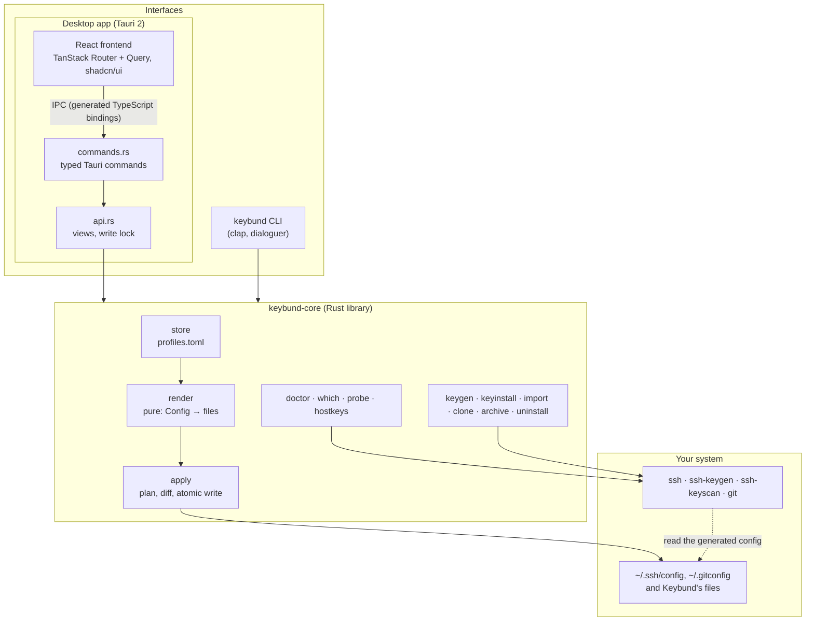
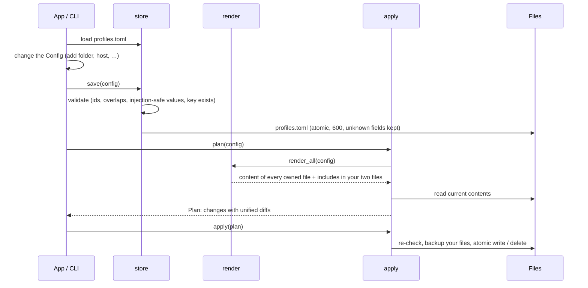
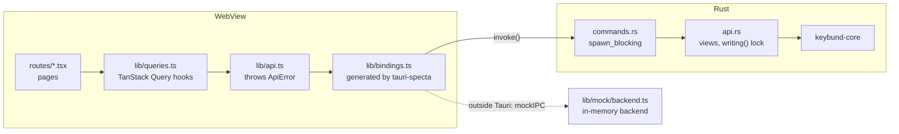

# Architecture

Keybund is one Rust library with two faces: a command-line tool and a desktop app. All logic – parsing,
validation, rendering, writing, checks – lives in the library; the CLI and the app only ask
questions and show results. This page explains the big picture and the decisions behind it; every
module is described in [Modules](modules.md).

## Principles

- **Standard files, no runtime.** Keybund's output is plain `ssh_config` and gitconfig. Nothing of
  Keybund runs while you use ssh or Git, so nothing of Keybund can break them at runtime, slow them
  down or need updating to keep working.
- **One source of truth.** `profiles.toml` describes what you want; every generated file is a pure
  function of it. A file can always be derived again, a diff always explains a change.
- **Own files, one include each.** Keybund writes only files it owns and adds a single include to
  each of your two configuration files. That keeps your configuration readable and makes uninstalling
  exact.
- **Ask the tools, don't guess.** “Which key?”, the connection test and the doctor ask `git config`,
  `ssh -G` and `ssh -v` what they actually do, instead of predicting it from Keybund's own data.
- **Never read secrets.** No private key is ever opened; passphrases never touch argv or disk.
- **Testable by construction.** Every function takes an `Env` (home and config folder), so all tests
  run against a temporary home; rendering has no I/O at all.

## The big picture

## From a change to the files on disk

Every change – a new folder in the app, `keybund edit`, an import – takes the same path:

- **Render** is a set of pure functions (`Config → String`), covered by snapshot tests: the same
  `profiles.toml` gives the same bytes on every machine.
- **Plan** compares the rendered contents with the disk and produces a `FileChange` per differing
  file, with a unified diff. The app's status line counts these changes; when it is not zero, a file
  was changed outside Keybund.
- **Apply** checks each file again against the content the plan was based on (so a file edited in
  between is never overwritten silently), backs up your own files and writes atomically.

The CLI shows the plan and asks before writing; the app writes immediately because every change is
small, validated and reversible – each key's tab **Generierte Config** shows the result.

## The desktop app

- **Typed IPC.** The Tauri commands are declared once in Rust; `tauri-specta` generates
  `bindings.ts` with every command and type. A test fails when the file is out of date
  (`just bindings` regenerates it), so the frontend cannot call a command with the wrong shape.
- **Thin commands.** `commands.rs` only takes the `Env` from the app state and runs the work on a
  blocking thread (ssh and git calls can take seconds). The logic that is specific to the app – view
  models, saving and applying in one step – is in `api.rs`, which is tested without Tauri.
- **One writer at a time.** All writing commands take a global lock (`api::writing()`), and on the
  frontend all mutations share one TanStack Query scope, so they run strictly one after another and
  each starts from fresh data. Two quick clicks never work on an outdated `profiles.toml`.
- **Keys, not text.** The backend never sends text for people. Errors, doctor checks, test results and
  notes are messages – a catalog key with arguments (`{ "key": "probe_connected", "args": { "account":
  "@octocat" } }`) – and the frontend renders them in the user's language with the same Paraglide
  catalogs as its own texts. Errors also carry a stable `kind` (`duplicate_alias`, `nested_folders`,
  …) to react to without parsing anything. The CLI renders the same keys from the same catalogs, so
  every text exists once per language.
- **Server state, not client state.** The frontend keeps no copy of the configuration. TanStack
  Query caches what the backend returns and invalidates everything after a write.
- **The mock backend.** Outside Tauri (browser preview, Vitest, Playwright, the screenshots) the
  frontend talks to `lib/mock/backend.ts`, an in-memory implementation of every command that mirrors
  the Rust behaviour – including validation errors, rendering and host key prompts. Contract tests
  keep the two in line.

## External programs

Keybund deliberately uses the system's OpenSSH and Git instead of libraries:

| Program | Used for |
|---|---|
| `ssh-keygen` | creating keys, reading fingerprints |
| `ssh -T -v` | connection tests (which key was accepted, as which account) |
| `ssh -G` | “which key?” for hosts – the effective configuration |
| `ssh-keyscan` | fetching host keys before the first connection |
| `ssh` with a small remote script | adding a public key to `authorized_keys` |
| `git config --show-origin` | “which key?” for folders, the global identity |
| `git rev-parse` | finding the repository and its git directory (worktrees) |
| `git -c core.sshCommand=… clone` | cloning with the right key |
| `xdg-open`, `flatpak-spawn --host`, `gio open` | opening the provider's page in the browser |

That way the behaviour is exactly what ssh and Git do on your machine – same version, same
configuration, same agent – and Keybund never has to re-implement either.

## Decisions worth knowing

- **Git chooses the key through `core.sshCommand`, not through `Host` blocks.** Several keys on one
  provider (`github.com`) cannot be told apart by hostname. `includeIf "gitdir:"` plus
  `core.sshCommand` selects the key by *where the repository is*, which is what people mean.
- **Servers match by alias and hostname.** `ssh nas` and `ssh 192.168.1.20` are the same server to a
  human; the `Host` block lists both.
- **`IdentitiesOnly` everywhere.** Predictable logins and no leaking of other keys beat the
  convenience of ssh trying everything.
- **The SSH include goes first, the Git include goes last.** OpenSSH takes the first value, Git the
  last – each include is placed where it wins, and moved back when something else gets in front.
- **Host keys are confirmed, not accepted.** `StrictHostKeyChecking=yes` after an explicit
  confirmation; the big Git providers' published keys are pinned in the code.
- **No automatic default key.** A default key replaces ssh's own key choice for every repository
  outside your folders, so it is only set when you ask for it.
- **Writes in the app are immediate.** Every change is small, validated and backed up, and its result
  is visible on the key's page; a separate “apply” step only added a way to forget it.
