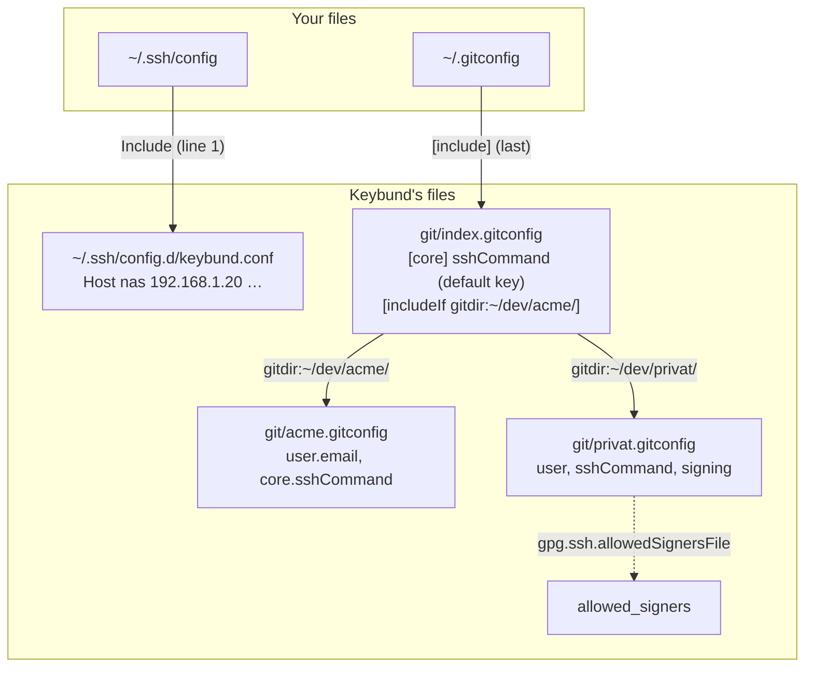

# What Keybund writes

Keybund does not run in the background and has no protocol of its own. It writes standard OpenSSH and
Git configuration files, and ssh and Git do the rest. This page shows every file, why it looks the
way it does, and how the pieces connect. In the app, the tab **Generierte Config** of each key shows
its part of these files.

## Overview

| File | Owner | Content | Read by |
|---|---|---|---|
| `~/.ssh/config` | **you** | one line added at the very top: `Include ~/.ssh/config.d/keybund.conf` | ssh |
| `~/.ssh/config.d/keybund.conf` | Keybund | a `Host` block per server and per aliased Git account | ssh, through the include |
| `~/.gitconfig` | **you** | one `[include]` added as the last entry | Git |
| `~/.config/keybund/git/index.gitconfig` | Keybund | the default key and one `includeIf "gitdir:…"` per Git folder | Git, through the include |
| `~/.config/keybund/git/<id>.gitconfig` | Keybund | per key: identity, `core.sshCommand`, signing | Git, through `includeIf` |
| `~/.config/keybund/allowed_signers` | Keybund | e-mail and public key of each signing key | Git, when verifying signatures |
| `~/.ssh/known_hosts.d/<id>` | Keybund and ssh | host keys of a key's servers | ssh, through `UserKnownHostsFile` |

Files owned by Keybund start with `# Managed by Keybund – manual changes will be overwritten.` In
your own two files Keybund only ever adds or moves its one include, and takes a backup first (see
[Backups](#backups)).



## SSH: `~/.ssh/config.d/keybund.conf`

```sshconfig
# Managed by Keybund – manual changes will be overwritten.
# Included from the top of ~/.ssh/config.

# Key: Privat
Host meinserver 1.2.3.4
    HostName 1.2.3.4
    User tristan
    Port 22
    IdentityFile ~/.ssh/privat_ed25519
    IdentitiesOnly yes
    AddKeysToAgent yes
    UserKnownHostsFile ~/.ssh/known_hosts.d/privat ~/.ssh/known_hosts
    UpdateHostKeys yes

# Key: Kunde B
Host github-kunde-b
    HostName github.com
    User git
    IdentityFile ~/.ssh/kunde-b_ed25519
    IdentitiesOnly yes
    AddKeysToAgent yes

Host *
```

Why each line is there:

- **`Host meinserver 1.2.3.4`** – a server matches by alias *and* by hostname/IP, so `ssh meinserver`
  and `ssh 1.2.3.4` behave the same. A Git account only gets a block when it has an alias: a block
  for plain `github.com` would add its key to every connection to GitHub, including those of other
  keys.
- **`User git`** for Git providers – otherwise `ssh -T github-kunde-b` would log in with your local
  user name.
- **`IdentitiesOnly yes`** – ssh offers only this key, not every key in the agent. That prevents
  “Too many authentication failures” on servers with a low `MaxAuthTries` and logins with the wrong
  account on GitHub.
- **`AddKeysToAgent yes`** – after you typed a passphrase once, the agent keeps the key; no prompt on
  every push.
- **`UserKnownHostsFile`** (servers, when known_hosts per key is on) – new host keys go to the key's
  own file, known ones in `~/.ssh/known_hosts` still count. **`UpdateHostKeys yes`** keeps that file
  current when a server rotates its keys (ssh does this only for the default file otherwise).
- **`Host *`** at the end – ssh's config parser stays in the last `Host` section until the next one.
  Without it, lines that follow the `Include` in your `~/.ssh/config` would only apply to Keybund's
  last host instead of to all hosts.

### The include line in `~/.ssh/config`

```sshconfig
Include ~/.ssh/config.d/keybund.conf

# … your own configuration, unchanged …
```

OpenSSH uses the **first** value it finds for each option, and an `Include` inside a `Host` block
only applies to that host. So Keybund's include must be the first directive of the file: then its
blocks win over a later `Host *` with another `IdentityFile`, and they apply everywhere. Keybund puts
it there, moves it back if something else got above it, and the doctor checks the position.

With **Include mit vollem Pfad** (`absolute_ssh_include`) the line is written with the full path –
needed for libssh before 0.10.2 (Dolphin/KIO on older distributions), which does not expand `~`.

## Git: `index.gitconfig` and one file per key

```ini title="~/.config/keybund/git/index.gitconfig"
# Managed by Keybund – manual changes will be overwritten.
# Included from ~/.gitconfig.

# Standard-Key: Privat
[core]
	sshCommand = ssh -i ~/.ssh/privat_ed25519 -o IdentitiesOnly=yes -o AddKeysToAgent=yes

[includeIf "gitdir:~/dev/privat/"]
	path = ~/.config/keybund/git/privat.gitconfig

[includeIf "gitdir:~/dev/acme/"]
	path = ~/.config/keybund/git/acme.gitconfig
```

```ini title="~/.config/keybund/git/acme.gitconfig"
# Managed by Keybund – manual changes will be overwritten.
# Key: Acme
[user]
	email = tristan@acme.example
[core]
	sshCommand = ssh -i ~/.ssh/acme_ed25519 -o IdentitiesOnly=yes -o AddKeysToAgent=yes
```

- **`core.sshCommand`** is how Git chooses the key, independent of the remote URL: `git push` in
  `~/dev/acme/app` runs exactly this ssh command. The default key's `sshCommand` sits at the top of
  `index.gitconfig`; a folder's include comes later and overrides it (in Git, the last value wins).
- **`includeIf "gitdir:~/dev/acme/"`** – the trailing `/` makes it match every repository below the
  folder (without it, only a repository *at* exactly that path would match). Keybund stores folders
  with symlinks resolved, because Git compares the real path of the repository's `.git` directory.
  For linked worktrees Git uses the main repository's `.git` directory, so a worktree outside the
  folder still belongs to the key of its main repository.
- **`[user]`** only contains what you set. An empty name or e-mail is left out, so the value from
  `~/.gitconfig` applies.
- Values that need it are quoted (`"…"`) – for example a key path with spaces.

### The include in `~/.gitconfig`

```ini
[user]
	name = Tristan
	email = tristan@example.org

# Added by Keybund
[include]
	path = ~/.config/keybund/git/index.gitconfig
```

In Git the **last** value of a setting wins. So Keybund's include must be the **last** entry: a
`[core] sshCommand` or `[user] email` added later below it – for example by
`git config --global user.email …` – would otherwise override the folder rules. Keybund moves its
include back to the end whenever it writes, and the doctor reports when it is no longer last. Your
own settings above it stay as they are and apply wherever no Keybund rule does.

### Commit signing

For a key with **Commits signieren**, its gitconfig additionally gets:

```ini
[user]
	signingkey = ~/.ssh/privat_ed25519.pub
[gpg]
	format = ssh
[commit]
	gpgsign = true
[gpg "ssh"]
	allowedSignersFile = ~/.config/keybund/allowed_signers
```

and `~/.config/keybund/allowed_signers` lists the signing keys, one per line:

```text
tristan@example.org namespaces="git" ssh-ed25519 AAAAC3NzaC1lZDI1NTE5AAAA…
```

`allowedSignersFile` sits in the key's own gitconfig, not globally, so an allowed-signers file you
configured yourself still applies everywhere else. Tags are not signed automatically
(`tag.gpgSign` would turn every lightweight tag into an annotated one); use `git tag -s`.

## How writing works

Every change – in the app immediately, in the CLI after a confirmation – follows the same path:

1. **Render.** From `profiles.toml` Keybund computes the complete content of every file it owns, and
   the new content of `~/.ssh/config` and `~/.gitconfig` with the include in place. Rendering is a
   pure function: same input, same output, byte for byte.
2. **Plan.** It compares that with what is on disk and gets a list of changes with a unified diff
   each – `keybund apply --dry-run` shows exactly this.
3. **Write.** Each file is checked again against the content the plan was computed from (a file
   changed in between is never overwritten silently), then written atomically: a temporary file in
   the same folder, `fsync`, rename. Files below `~/.ssh`, including `~/.ssh/config`, get mode `600`
   (ssh refuses a group-writable config), the Git files `644`; `~/.gitconfig` keeps its permissions.
   Symlinks – for example from a dotfiles manager – are written through, not replaced.
4. **Remove.** Files that are no longer needed (an archived key's gitconfig, `allowed_signers` when
   no key signs) are deleted.

In the app a global lock serialises all writes, so two quick clicks can never interleave.

## Backups

Before Keybund changes `~/.ssh/config` or `~/.gitconfig`, it copies the file to
`~/.ssh/config.keybund-backup` or `~/.gitconfig.keybund-backup`:

- As long as Keybund's include is **not yet** in the file, every write refreshes the backup – so it
  always holds your latest version from before Keybund.
- Once the include is in, the backup is kept as it is.
- If the file did not exist before Keybund, a stale backup is removed: “restore” then means the file
  goes away.

`keybund uninstall --restore-backups` (or the option in **Keybund entfernen**) puts these backups
back. Removing taken-over blocks after an import uses the same backup.

## What Keybund never touches

- **Private keys.** Keybund knows paths, fingerprints and public keys. Keys are created by
  `ssh-keygen`; archiving moves the files, uninstalling leaves them alone.
- **Your settings** in `~/.ssh/config` and `~/.gitconfig` – only the one include line each.
- **Repositories.** Nothing is written into `.git/config`; the clone helper passes the key with
  `git -c` for that one command.
- **`~/.ssh/known_hosts`** – except that the pinned host keys of GitHub, GitLab.com and Bitbucket
  are appended when you first test against them, and server host keys you confirmed when known_hosts
  per key is off.
