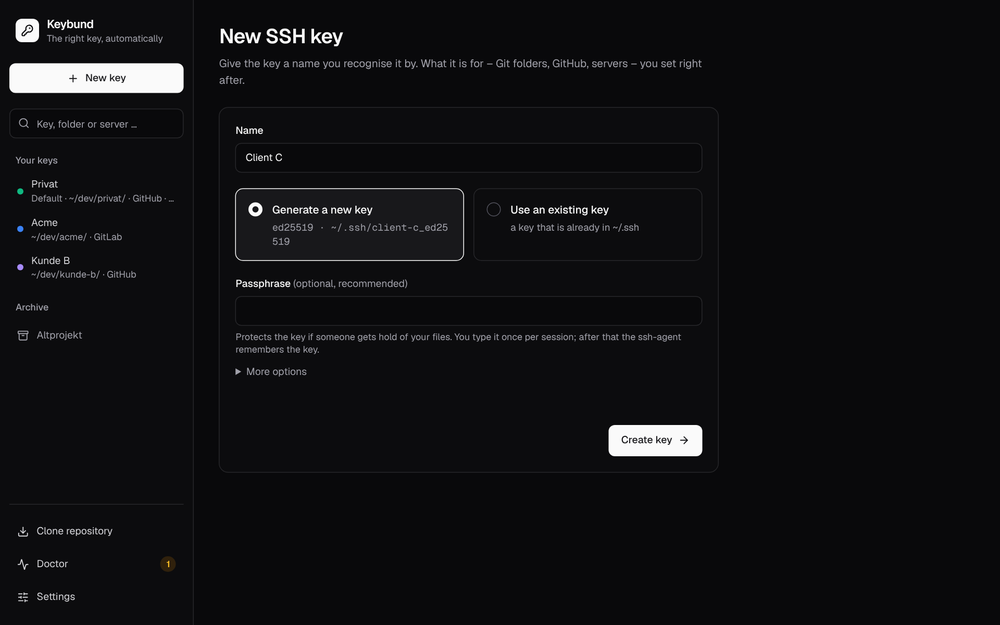
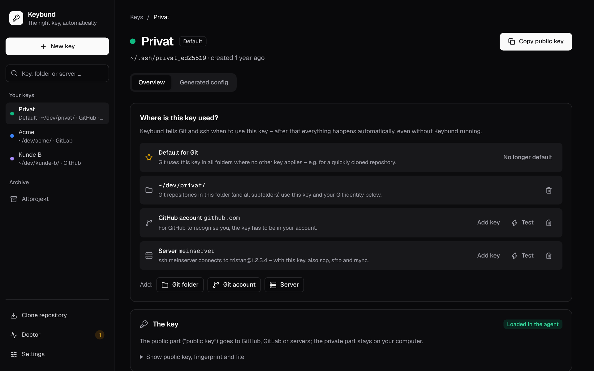
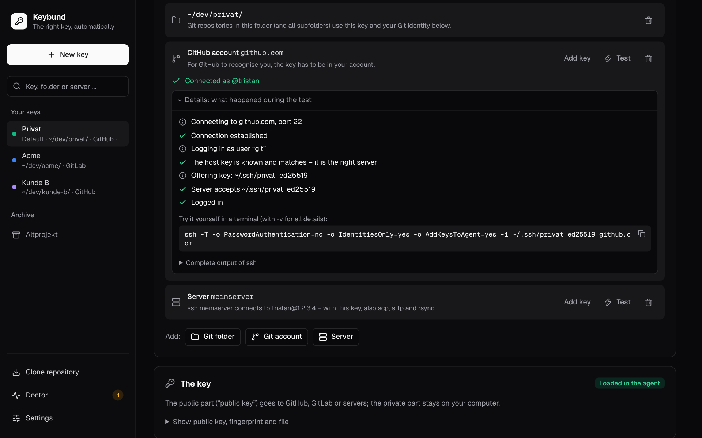
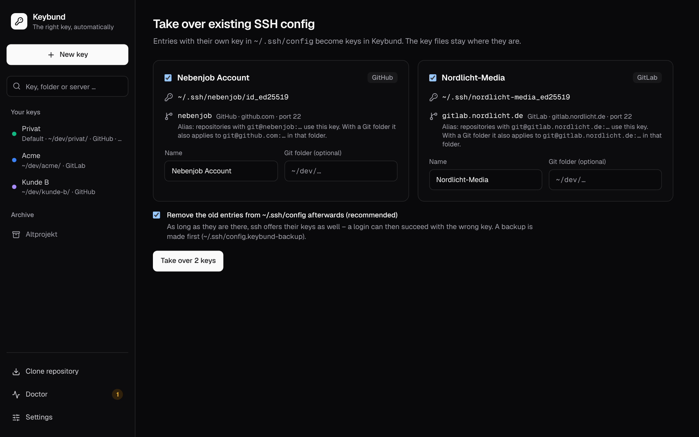

# First steps

This page walks through the first ten minutes: one key for your client work on GitHub, one for a
server, and – if you already have a `~/.ssh/config` – taking over what is there. The labels below are
those of the English interface; with a German system the app is in German (switch it under
**Settings → Language**).

!!! tip "Already have keys and a `~/.ssh/config`?"
    Start with [Taking over an existing setup](#taking-over-an-existing-setup) below. Keybund turns
    your existing `Host` blocks into keys in one click and leaves the key files where they are.

## 1. Create a key

Click **New key**, give it a name you recognise – “Client C”, “Private”, “NAS” – and click
**Create key**.



- **Generate a new key** runs `ssh-keygen -t ed25519` and stores it as
  `~/.ssh/<name>_ed25519` (the folder can be changed in the settings). Ed25519 is the modern default
  that GitHub, GitLab, Bitbucket and every current OpenSSH server accept.
- **Use an existing key** picks a key that is already in `~/.ssh`. Nothing
  is moved or copied.
- A **passphrase** is optional but recommended: it protects the key if someone gets hold of your
  files. You type it once per session; after that `ssh-agent` keeps the key unlocked (Keybund writes
  `AddKeysToAgent yes` everywhere).

Under **More options** you can change the key's comment – the text at the end of the
public key by which you recognise it on GitHub or on a server.

On the command line:

```sh
keybund new --name "Client C"         # asks the remaining questions in the terminal
```

## 2. Say where the key is used

A new key is not used anywhere yet. On its page, under **Where is this key used?**, add what it is
for:



### A Git folder

**Add: Git folder**, e.g. `~/dev/client-c/`. Every repository in that folder
and below it now uses this key for `git push`, `pull` and `fetch` – whatever the remote URL is. With
the first folder you can also set the **name and e-mail for commits** in these repositories; leave
them empty to keep the identity from `~/.gitconfig`.

Keybund then asks **Where is the code?**: GitHub, GitLab, Bitbucket – or later.
That adds the matching Git account to the key.

### A Git account

A **Git account** is GitHub, GitLab (also self-hosted, e.g. `gitlab.company.com`) or
Bitbucket. It says “the public key of this key has to be in that account”. Click **Add key**:
Keybund copies the public key to the clipboard and opens the page where you paste it
(e.g. `https://github.com/settings/ssh/new`). Paste it, save, then click **Done – test now**.

!!! note "Make sure the browser is logged into the right account"
    The test shows the account GitHub or GitLab logged you in as (“Connected as @client-c-dev”), so
    you see immediately if the key ended up in the wrong account.

### A server

**Server**: hostname or IP, an optional alias (`nas`), user and port. Afterwards `ssh nas`,
`ssh 192.168.1.20`, `scp`, `sftp`, `rsync` and Dolphin's `sftp://nas` all use this key.

**Add key** on a server works like `ssh-copy-id`: Keybund logs in the way that already works
for you (another key, or the server's password, asked once) and appends the public key to
`~/.ssh/authorized_keys` on the server.

Before the first connection to a server, Keybund shows its **host key fingerprint** and asks you to
confirm it (**Fingerprint matches**). Compare it with what the server's admin
or console shows (`ssh-keygen -lf /etc/ssh/ssh_host_ed25519_key.pub` on the server). The published
keys of GitHub, GitLab.com and Bitbucket are built in and need no confirmation. See
[Security and host keys](security.md).

### The default key (optional)

**Default for Git** makes Git use this key in every repository that is **not** in
one of your Git folders – a quickly cloned repository in `~/Downloads`, for example. Without a
default key, ssh simply tries your keys as it always did. Set it on the key page or under
**Settings**.

## 3. Test

Every Git account and server has **Test**. The test runs `ssh -T` with only this key
(`IdentitiesOnly=yes`) and explains in plain words what happened – connection, host key, which key
was offered, which key the server accepted:



If a test fails because the server does not know the key yet, the matching button is right next to
it (**Copy public key & open GitHub page**, **Add key on nas**). The last result of each key is kept and
shown on the overview.

On the command line: `keybund test client-c` (exit code 0 on success).

## 4. Work as usual

That's it. Close Keybund. In `~/dev/client-c/` every `git push` uses the Client C key and commits
carry the Client C e-mail; `ssh nas` uses the NAS key. To check what applies where, type a folder or
host into the search field of the sidebar, or run `keybund which` in a repository:

```text
$ cd ~/dev/client-c/app && keybund which
~/dev/client-c/app
  Key            ~/.ssh/client-c_ed25519
  Fingerprint    SHA256:2LX3eQAAjZ38jLPbuDwcWxLYGoRXCyA4EahseK644Yf
  Key            Client C
  Quelle         ~/.config/keybund/git/client-c.gitconfig · via includeIf "gitdir:~/dev/client-c/"
  Git-Identität  Tristan <tristan@client-c.com>
  IdentitiesOnly ja, nur dieser Key wird angeboten
  Agent          geladen
```

To clone a new repository into the right folder with the right key – even before `includeIf` can
apply – use **Clone repository** or `keybund clone git@github.com:client-c/app.git`.

## Taking over an existing setup

If your `~/.ssh/config` already has blocks like

```sshconfig
# Side job
Host github-sidejob
    HostName github.com
    User git
    IdentityFile ~/.ssh/sidejob_ed25519
```

the overview offers **Take over**. In the app it is one click (**Take over 2 keys**):

1. Every `Host` block with its own `IdentityFile` becomes a key in Keybund. The key files stay where
   they are. Aliases stay aliases; a plain `Host github.com` becomes the default key for github.com
   (if there is none yet).
2. Keybund writes its configuration.
3. The taken-over blocks are removed from `~/.ssh/config`, after a backup to
   `~/.ssh/config.keybund-backup`. You can untick this, but it is recommended: as long as an
   `IdentityFile` for github.com is still there, ssh offers that key *in addition* to Keybund's, and
   a login can succeed with the wrong key. Blocks with more than Keybund handles (`ProxyJump`,
   `LocalForward`, several `IdentityFile` lines …) are always kept.



On the command line: `keybund import` (asks for each block) or `keybund import --all --yes`.

Afterwards give the imported keys a Git folder where it makes sense, so commits in those folders get
the right identity too.
